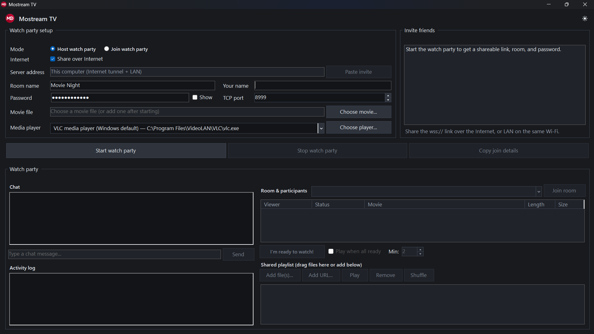
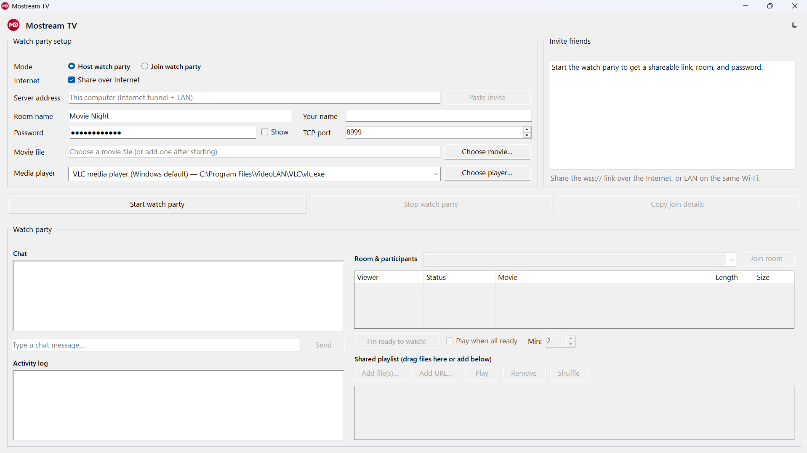

<div align="center">


# Mostream TV

**Private, self-hosted watch parties for Windows — watch movies in sync with friends, anywhere.**

-0078D6)


[**Download**](https://github.com/Aragami007/mostream-tv/releases/latest) ·
[Quick start](#-quick-start) ·
[Host a party](#-tutorial-1--host-a-watch-party) ·
[Join a party](#-tutorial-2--join-a-friends-watch-party) ·
[Troubleshooting](#-troubleshooting)

</div>

---

<p align="center">
  
</p>

## 📖 Table of contents

- [What is Mostream TV?](#-what-is-mostream-tv)
- [Features](#-features)
- [Screenshots](#-screenshots)
- [Requirements](#-requirements)
- [Installation](#-installation)
- [Quick start](#-quick-start)
- [Tutorial 1 — Host a watch party](#-tutorial-1--host-a-watch-party)
- [Tutorial 2 — Join a friend's watch party](#-tutorial-2--join-a-friends-watch-party)
- [Tutorial 3 — During the party](#-tutorial-3--during-the-party)
- [Interface guide](#-interface-guide)
- [How connections work](#-how-connections-work)
- [Troubleshooting](#-troubleshooting)
- [FAQ](#-faq)
- [Build from source](#%EF%B8%8F-build-from-source)
- [Project documentation](#-project-documentation)
- [Credits and licensing](#-credits-and-licensing)

---

## 🎬 What is Mostream TV?

Mostream TV is a Windows desktop app that lets you and your friends **watch the same movie at the same time**, even when you're in different cities. Everything happens in one window — hosting a party, joining a friend's party, chatting, and managing a shared playlist.

**Important:** Mostream TV does **not** upload or stream your movie to anyone. Each person plays **their own copy** of the movie (or a stream they can access) in their own media player. Mostream TV keeps everyone in sync — when someone pauses, seeks, or plays, everyone's player does the same.

```text
   You (host)                                         Your friend
 ┌──────────────┐     only sync commands + chat      ┌──────────────┐
 │ Mostream TV  │ ◄────────────────────────────────► │ Mostream TV  │
 │      │       │   (pause / play / seek / ready)    │      │       │
 │  VLC + your  │                                    │  VLC + their │
 │  movie file  │                                    │  movie file  │
 └──────────────┘                                    └──────────────┘
```

## ✨ Features

| | Feature | What it means for you |
|---|---|---|
| 🌍 | **Share over Internet** | One checkbox creates a secure `wss://` link. No router setup, no Hamachi, works behind CGNAT/double-NAT. |
| 🏠 | **LAN / same Wi-Fi mode** | Friends on the same network can connect directly with your local IP. |
| 🔗 | **One-click invites** | **Copy join details** on the host, **Paste invite** on the friend's side — all fields fill in automatically. |
| ⏯️ | **Synchronized playback** | Play, pause, and seek stay in sync for everyone in the room. |
| 💬 | **Chat + Activity log** | Chat with friends; room and sync events are shown separately so conversation stays readable. |
| ✅ | **Ready check & auto-play** | Everyone marks themselves ready; optionally start playing automatically once enough people are ready. |
| 📃 | **Shared playlist** | Add files, URLs, or drag-and-drop movies into a playlist everyone shares. |
| 🎞️ | **Many media players** | Auto-detects VLC, Windows Media Player, mpv, mpv.net, MPC-HC, MPC-BE, and more. |
| 🌗 | **Light & Dark themes** | Toggle from the icon in the top-right corner; your choice is remembered. |
| 🧹 | **Clean shutdown** | Server, tunnel, and player all close automatically when you stop the party or close the app. |

## 🖼️ Screenshots

<table>
  <tr>
    <th>Dark theme</th>
    <th>Light theme</th>
  </tr>
  <tr>
    <td></td>
    <td></td>
  </tr>
</table>

---

## 💻 Requirements

### Everyone (host and friends)

| Requirement | Needed? | Download |
|---|---|---|
| **Windows 10 or Windows 11 (64-bit)** | ✅ Required | — |
| **A supported media player** | ✅ Required (VLC recommended) | See the table below |
| **The same movie file** (or an accessible stream URL) | ✅ Required | Each viewer needs their own copy |
| **.NET 8 Desktop Runtime** | ⚠️ Only if you run from the source repository | [Download .NET 8](https://dotnet.microsoft.com/en-us/download/dotnet/8.0) → choose **.NET Desktop Runtime 8.x — Windows x64** |

> [!TIP]
> If you use the **installer** or the **portable ZIP** from the Releases page, you do **not** need to install .NET or Syncplay — both are already bundled inside.

### Supported media players

Install **at least one** of these. Mostream TV detects them automatically and lists them in the **Media player** dropdown.

| Player | Notes | Download |
|---|---|---|
| **VLC media player** ⭐ | Recommended for most users | [videolan.org/vlc](https://www.videolan.org/vlc/) |
| **Windows Media Player** | Already included with most Windows installs | Built into Windows |
| **mpv** | Lightweight, keyboard-driven | [mpv.io/installation](https://mpv.io/installation/) |
| **mpv.net** | mpv with a Windows-friendly interface | [github.com/mpvnet-player/mpv.net](https://github.com/mpvnet-player/mpv.net/releases) |
| **MPC-HC** | Media Player Classic – Home Cinema | [github.com/clsid2/mpc-hc](https://github.com/clsid2/mpc-hc/releases) |
| **MPC-BE** | Media Player Classic – Black Edition | [sourceforge.net/projects/mpcbe](https://sourceforge.net/projects/mpcbe/) |
| Shoukaku, Memento, MPlayer | Also detected if installed | — |

### Downloaded automatically (no action needed)

| Component | When | Where |
|---|---|---|
| **cloudflared** (official Cloudflare tunnel helper) | The first time you **host** with **Share over Internet** on | `%LOCALAPPDATA%\MoStreamTV\Runtime` |

Friends who only **join** never need cloudflared.

---

## 📦 Installation

Pick **one** of the three options below.

### Option A — Installer (recommended for beginners)

1. Go to the [**latest release**](https://github.com/Aragami007/mostream-tv/releases/latest).
2. Under **Assets**, download **`MostreamTV-Setup-<version>-windows-x64.exe`**.
3. Double-click the downloaded file and click **Install**.
4. Mostream TV launches automatically. It also adds **Start Menu** and **Desktop** shortcuts.

To uninstall later: **Settings → Apps → Installed apps → Mostream TV → Uninstall**.

### Option B — Portable ZIP (no installation)

1. From the [**latest release**](https://github.com/Aragami007/mostream-tv/releases/latest), download **`MostreamTV.Host-<version>-windows-x64.zip`**.
2. Right-click the ZIP → **Extract All…** and choose any folder (for example, `Documents\Mostream TV`).
3. Open the extracted folder and double-click **`MostreamTV.Host.exe`**.

### Option C — Run from the source repository

1. Install the [**.NET 8 Desktop Runtime**](https://dotnet.microsoft.com/en-us/download/dotnet/8.0) (Windows x64).
2. Download the repository: click the green **Code** button → **Download ZIP**, then extract it (or `git clone https://github.com/Aragami007/mostream-tv.git`).
3. Double-click **`RUN_MOSTREAM_TV.bat`** in the repository folder (or run `dist\MostreamTV.Host\MostreamTV.Host.exe`).

> [!NOTE]
> **"Windows protected your PC" warning?** Mostream TV is currently an unsigned build, so Windows SmartScreen may show this message. Click **More info → Run anyway**. If you'd rather not run an unsigned app, you can [build it yourself from source](#%EF%B8%8F-build-from-source).

> [!NOTE]
> **Windows Firewall prompt?** The first time you host, Windows may ask whether to allow network access. Click **Allow** so friends can connect.

---

## 🚀 Quick start

**Host (you):** open Mostream TV → enter **Your name** → pick a movie → **Start watch party** → **Copy join details** → send them to your friends.

**Friends:** open Mostream TV → select **Join watch party** → **Paste invite** → enter **Your name** → pick the same movie → **Join watch party**.

That's it — press play and everyone watches together. The detailed tutorials follow below.

---

## 🎉 Tutorial 1 — Host a watch party

Follow these steps on the computer that will **host** the party.

**Step 1 — Open Mostream TV.**
Under **Watch party setup**, make sure **Mode** is set to **Host watch party** (this is the default).

**Step 2 — Choose how friends will connect.**

- Friends in **other places** → keep **Share over Internet** ✅ checked.
- Friends on **your Wi-Fi only** → uncheck it. The server address changes to *This computer (LAN / Wi-Fi only)*.

**Step 3 — Fill in the room details.**

| Field | What to enter |
|---|---|
| **Room name** | Any name, e.g. `Movie Night`. Friends join this room. |
| **Your name** | The name other people will see in chat and the participant list. |
| **Password** | A password is generated for you. Tick **Show** to see it, or type your own. |
| **TCP port** | Leave as `8999`. If that port is busy, Mostream TV picks a free one automatically. |

**Step 4 — Pick your movie and player.**

- Click **Choose movie…** and select the movie file. (You can skip this and add movies later.)
- Choose a player from the **Media player** dropdown. If your player isn't listed, click **Choose player…** and browse to its `.exe` file.

**Step 5 — Start the party.**
Click **Start watch party**. After a few seconds, the **Invite friends** box shows your shareable `wss://…` link, the room name, and the password. Your media player opens with the movie.

**Step 6 — Invite your friends.**
Click **Copy join details** and paste the text into WhatsApp, Discord, email, or any chat app. It contains everything your friends need:

```text
Server: wss://example-words.trycloudflare.com
Room: Movie Night
Password: ••••••••••••
LAN: 192.168.1.20:8999
```

> [!IMPORTANT]
> Every new party gets a **new link and password**. Send fresh join details each time you start a party.

**Step 7 — When you're done,** click **Stop watch party** (or just close Mostream TV). The server, tunnel, and media player all shut down automatically.

---

## 🤝 Tutorial 2 — Join a friend's watch party

Follow these steps on a **friend's** computer.

**Step 1 — Get the invite.** Ask the host to send you their join details, then **copy the whole message** to your clipboard.

**Step 2 — Switch to Join mode.** Open Mostream TV and under **Mode**, select **Join watch party**.

**Step 3 — Paste the invite.** Click **Paste invite**. The **Server address**, **Room name**, and **Password** fill in automatically.

<details>
<summary>Prefer to type it in manually?</summary>

- **Server address:** the `wss://…` link (Internet), or the `IP:port` shown after `LAN:` (same Wi-Fi).
- **Room name:** exactly as the host wrote it.
- **Password:** the host's password.

</details>

**Step 4 — Enter your name.** Type a name in **Your name** so others know who you are.

**Step 5 — Pick the same movie.** Click **Choose movie…** and select **your copy** of the same movie the host is playing, then choose your **Media player**.

**Step 6 — Join.** Click **Join watch party**. You'll appear in **Room & participants**, and your player will follow the host's playback.

**Step 7 — Leave** at any time by clicking **Leave watch party** or closing the app.

---

## 🍿 Tutorial 3 — During the party

### Chatting
Type in the **Type a chat message…** box and press **Send**. Messages appear under **Chat**, while joins, leaves, pauses, and seeks appear under **Activity log**.

### Controlling playback
Use your **media player's normal controls** (play, pause, seek). Mostream TV mirrors those actions to everyone in the room automatically.

### Getting everyone ready
1. Each viewer clicks **I'm ready to watch!** when they're set.
2. To start automatically, tick **Play when all ready** and set **Min:** to the minimum number of viewers that must be ready (default `2`).
3. Watch the **Status** column in **Room & participants** to see who is ready.

### Using the shared playlist
- **Add file(s)…** — add movies from your computer.
- **Add URL…** — add an online stream link.
- **Drag and drop** files straight onto the playlist area.
- Select an item and click **Play**, **Remove**, or use **Shuffle**.

> [!TIP]
> If a participant's movie file differs from yours, hover over their row in **Room & participants** to see the difference. Double-click the row to switch to that file if you have it locally.

### Switching rooms
Pick a room from the **Room & participants** dropdown and click **Join room**.

### Changing the theme
Click the ☀️ / 🌙 icon in the top-right corner to switch between Dark and Light themes.

---

## 🧭 Interface guide

<details>
<summary><b>Click to expand a description of every part of the window</b></summary>

#### Watch party setup
| Control | Purpose |
|---|---|
| **Mode** | *Host watch party* (run the server) or *Join watch party* (connect to someone else). |
| **Internet → Share over Internet** | Host only. Creates a secure Internet link via a Cloudflare Quick Tunnel. |
| **Server address** | Host: shows where the party runs. Join: the friend's `wss://` link or `IP:port`. |
| **Paste invite** | Join mode: fills in server, room, and password from copied join details. |
| **Room name / Your name** | The room to create or join, and your display name. |
| **Password / Show** | The room password; tick **Show** to reveal it. |
| **TCP port** | Network port for the server (default `8999`). |
| **Movie file / Choose movie…** | The local movie to play. |
| **Media player / Choose player…** | The detected player to use, or browse for another one. Your choice is remembered. |

#### Action buttons
| Button | Purpose |
|---|---|
| **Start watch party** / **Join watch party** | Starts hosting or connects to a friend (label changes with the mode). |
| **Stop watch party** / **Leave watch party** | Ends your session and closes the player cleanly. |
| **Copy join details** | Copies the invite (link, LAN address, room, password) to the clipboard. |

#### Invite friends panel
Shows the shareable `wss://` link, LAN address, room, and password once your party is running. In Join mode, this panel shows the friend's server details instead.

#### Watch party panel
| Area | Purpose |
|---|---|
| **Chat** | Messages between viewers. |
| **Activity log** | Room and sync events (joins, pauses, seeks, errors). |
| **Room & participants** | Each viewer's name, ready status, movie, length, and file size. |
| **I'm ready to watch! / Play when all ready / Min** | Readiness and auto-play controls. |
| **Shared playlist** | The queue of movies and URLs shared by the room. |

</details>

---

## 🌐 How connections work

### Over the Internet (default)
With **Share over Internet** on, the host's Mostream TV opens a temporary, encrypted `wss://<random>.trycloudflare.com` tunnel using Cloudflare's free Quick Tunnels. Friends connect through this link with no VPN, no router port forwarding, and no extra downloads — it even works behind CGNAT or double-NAT. Each party gets a **new random link**, and the tunnel closes when the party stops.

### On the same Wi-Fi / LAN
Friends on your network can connect directly to the `LAN: <ip>:<port>` address that Mostream TV shows. Uncheck **Share over Internet** if you only want local access.

### Manual port forwarding (advanced)
If you turn the tunnel off but still want Internet friends to join, you'll need a router port-forward, a fixed LAN IP, and a Windows Firewall rule. Note that this direct connection is **not encrypted**. See [Networking and security](docs/NETWORKING.md) for details.

---

## 🛠️ Troubleshooting

| Problem | What to try |
|---|---|
| **"Windows protected your PC"** | Click **More info → Run anyway** (unsigned build). |
| **No players in the Media player dropdown** | Install [VLC](https://www.videolan.org/vlc/), restart Mostream TV, or click **Choose player…** to browse to your player's `.exe`. |
| **Friend can't connect over the Internet** | Make sure **Share over Internet** was on, the friend copied the **latest** invite (links change every party), and the room name and password match exactly. |
| **Friend can't connect over LAN** | Confirm you're on the same network, Wi-Fi "client isolation" is off, the LAN IP belongs to your active Wi-Fi/Ethernet adapter, and Windows Firewall allows `syncplayServer.exe`. |
| **"Port already in use" / port conflict** | Change the **TCP port** to another number (e.g. `9000`), or close the program using port `8999`. |
| **Wrong password or unreachable server** | Mostream TV shows the error immediately — re-paste the invite and try again. |
| **Playback keeps jumping back** | Make sure everyone has the **same movie file** (same length). Check the **Movie / Length / Size** columns in **Room & participants**. |
| **First Internet host start is slow** | Mostream TV is downloading `cloudflared.exe` once. Later starts are faster. |

When reporting a bug, please include your Mostream TV version, Windows version, whether the friend is on LAN or the Internet, and the exact error message — and **remove passwords and public IP addresses**. Use the [bug report template](https://github.com/Aragami007/mostream-tv/issues/new/choose).

---

## ❓ FAQ

**Does Mostream TV send my movie to my friends?**
No. Only sync commands (play, pause, seek, ready) and chat are sent. Everyone needs their own copy of the movie.

**Do my friends need to install anything besides Mostream TV?**
Just a supported media player (VLC is easiest) and the movie file.

**Is it free?**
Yes. Mostream TV is open source under the Apache License 2.0, and the Cloudflare Quick Tunnels it uses are free.

**Does it work on macOS or Linux?**
Not currently — Mostream TV supports Windows 10 and 11 (64-bit) only.

**What happens when I close the app?**
The private server, Internet tunnel, sync engine, and media player are all shut down cleanly.

---

## 🏗️ Build from source

### Prerequisites

- Windows 10 or 11
- [.NET 8 SDK](https://dotnet.microsoft.com/en-us/download/dotnet/8.0) or newer
- `vendor/Syncplay_1.7.6_Portable.zip` (included in this repository; from the [official Syncplay release](https://github.com/Syncplay/syncplay/releases))
- [Git](https://git-scm.com/downloads) (optional, for cloning)

### Build and run

```powershell
git clone https://github.com/Aragami007/mostream-tv.git
cd mostream-tv

# Run directly
dotnet run --project .\MostreamTV.Host\MostreamTV.Host.csproj

# Or build and publish to dist\
dotnet build   .\MostreamTV.Host\MostreamTV.Host.csproj -c Release
dotnet publish .\MostreamTV.Host\MostreamTV.Host.csproj -c Release -o .\dist\MostreamTV.Host
```

### Create release packages

```powershell
.\scripts\Build-Release.ps1
```

This produces the installer (`MostreamTV-Setup-<version>-windows-x64.exe`) and the portable ZIP (`MostreamTV.Host-<version>-windows-x64.zip`) in the `artifacts\` folder. The same build runs automatically on GitHub Actions for every push to `main`.

### Project structure

```text
mostream-tv/
├── MostreamTV.Host/          # Main Windows Forms app
│   ├── Hosting/              # Syncplay server/client management, player detection
│   ├── Networking/           # Cloudflare tunnel + WebSocket bridge, LAN address
│   ├── UI/                   # Watch party panel, themes, dialogs, WMP player
│   └── Assets/               # Icons and logo
├── MostreamTV.Installer/     # Standalone Windows installer
├── scripts/Build-Release.ps1 # Builds installer + portable ZIP
├── vendor/                   # Bundled Syncplay 1.7.6 portable runtime
├── dist/                     # Prebuilt app (requires .NET 8 Desktop Runtime)
└── docs/                     # Architecture, networking, testing, screenshots
```

---

## 📚 Project documentation

| Document | Contents |
|---|---|
| [Architecture](docs/ARCHITECTURE.md) | How the app, Syncplay runtime, and tunnel fit together |
| [Networking and security](docs/NETWORKING.md) | Internet tunnel, LAN, and port-forwarding details |
| [Testing](docs/TESTING.md) | Automated build checks and manual acceptance tests |
| [Contributing](CONTRIBUTING.md) | Development setup and pull request guidelines |
| [Security policy](SECURITY.md) | How to report vulnerabilities privately |
| [Changelog](CHANGELOG.md) | Version history |

---

## 📜 Credits and licensing

Made with ❤️ by **Mohit** and **Kausthuba**.

- Mostream TV is licensed under the **Apache License 2.0** — see [LICENSE](LICENSE) and [NOTICE](NOTICE).
- Synchronization and media-player control are powered by the bundled **[Syncplay](https://github.com/Syncplay/syncplay) 1.7.6** runtime (Apache License 2.0). Its license and third-party notices are kept in [`MostreamTV.Host/licenses/`](MostreamTV.Host/licenses/).
- The optional Internet tunnel uses Cloudflare's official **[cloudflared](https://github.com/cloudflare/cloudflared)** (Apache License 2.0).

Mostream TV is an independent project and is not endorsed by or affiliated with the Syncplay project or Cloudflare.
